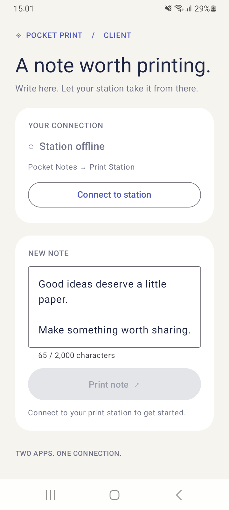
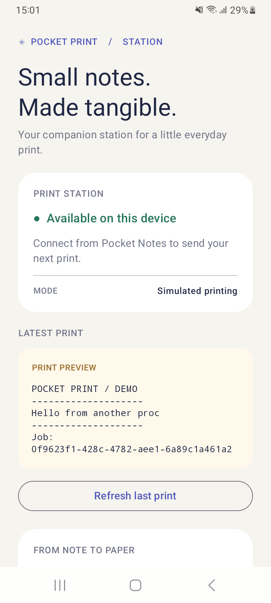
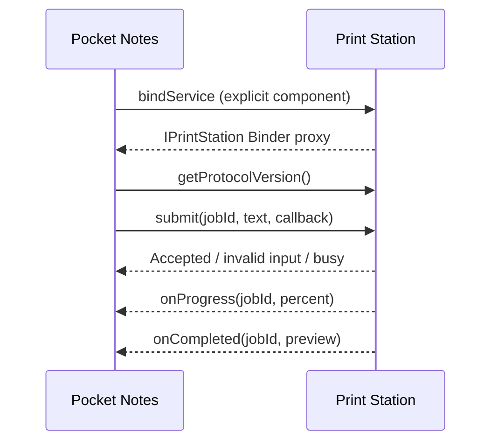

# Pocket Print

Two Android apps built with **Kotlin and Jetpack Compose**, demonstrating interprocess communication using **AIDL and Binder**. Pocket Notes sends a text job to Print Station, which simulates printing and returns progress and completion through callbacks.

## Screenshots

<p>
  
  
</p>

## Project structure

| Directory | Purpose |
| --- | --- |
| `notes` | Client app: binds to the service, submits notes and displays callbacks |
| `station` | Service app: validates requests, processes jobs and saves the latest print preview |
| `contract/src/main/aidl` | Shared AIDL interfaces compiled into both apps |
| `ui/src/main/kotlin` | Shared Compose theme and reusable UI components |

## How it works



The apps run in separate processes. The client makes remote calls on a worker thread and posts callback updates to the UI thread. The service handles concurrent Binder calls with atomic admission control and processes one job at a time on a background worker.

`submit()` returns an admission result immediately; completion arrives separately through the `oneway` callback interface. Job IDs correlate callbacks with requests. A signature-level permission restricts service access to apps signed with the same certificate.

## Build and run

Requirements: Android SDK 36, JDK 17 or newer, and an Android 8.0+ device or emulator.

Open the project in Android Studio, or build from the project root:

```sh
./gradlew :station:assembleDebug :notes:assembleDebug
adb install -r station/build/outputs/apk/debug/station-debug.apk
adb install -r notes/build/outputs/apk/debug/notes-debug.apk
```

Install Print Station first. Build both apps on the same machine so they use the same debug signing certificate. For release builds, sign both apps with the same certificate.

1. Open **Pocket Notes** and tap **Connect to station**.
2. Enter a note and tap **Print note**.
3. Watch the progress callbacks and completed preview.
4. Open **Print Station** and tap **Refresh last print** to view the saved output.

## Test scenarios

| Action | Expected result |
| --- | --- |
| Print a note while connected | Accepted, progress updates, then completed preview |
| Submit an empty note or more than 2,000 characters | Invalid-input rejection |
| Print a note | Print button is disabled until completion |
| Submit a concurrent request through AIDL | Busy rejection |
| Disconnect from the station | Print button becomes unavailable |
| Connect without Print Station installed | Installation prompt in the log |
| Install apps signed with different certificates | Permission denied |

## Limitations

Printing is simulated; no printer or network connection is required. Leaving Pocket Notes releases the service binding, so reconnect when returning. Active jobs are not durable across service shutdown or process death. Only the most recent completed preview is persisted, and the client log resets when its activity is recreated.

## References

- [Android AIDL guide](https://developer.android.com/develop/background-work/services/aidl)
- [Bound services guide](https://developer.android.com/develop/background-work/services/bound-services)
